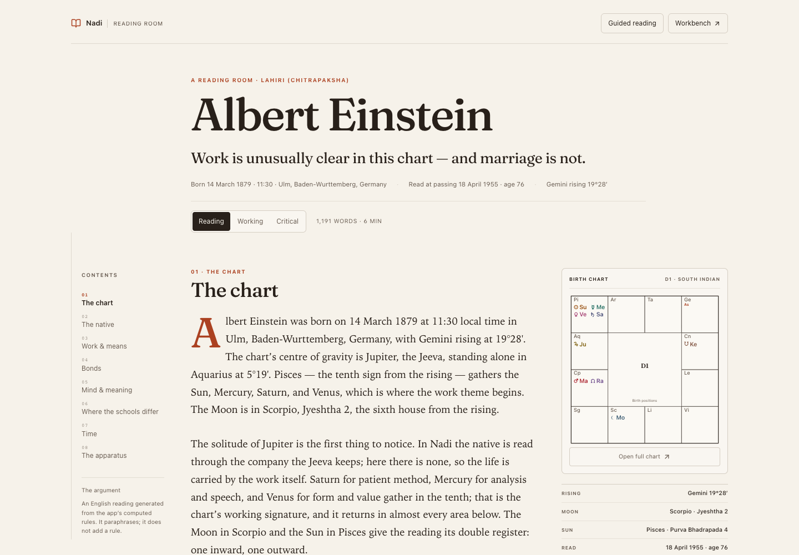
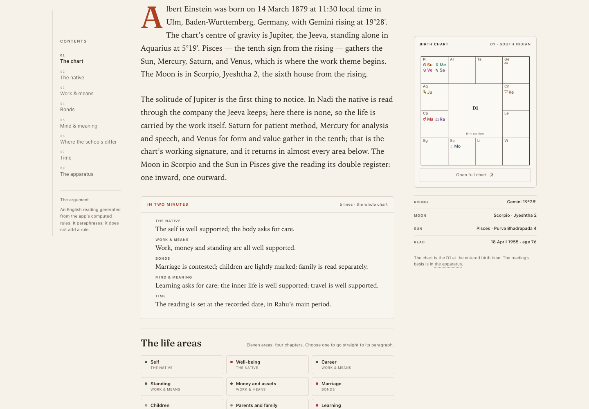
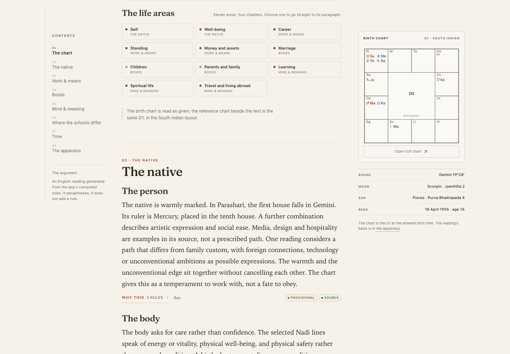
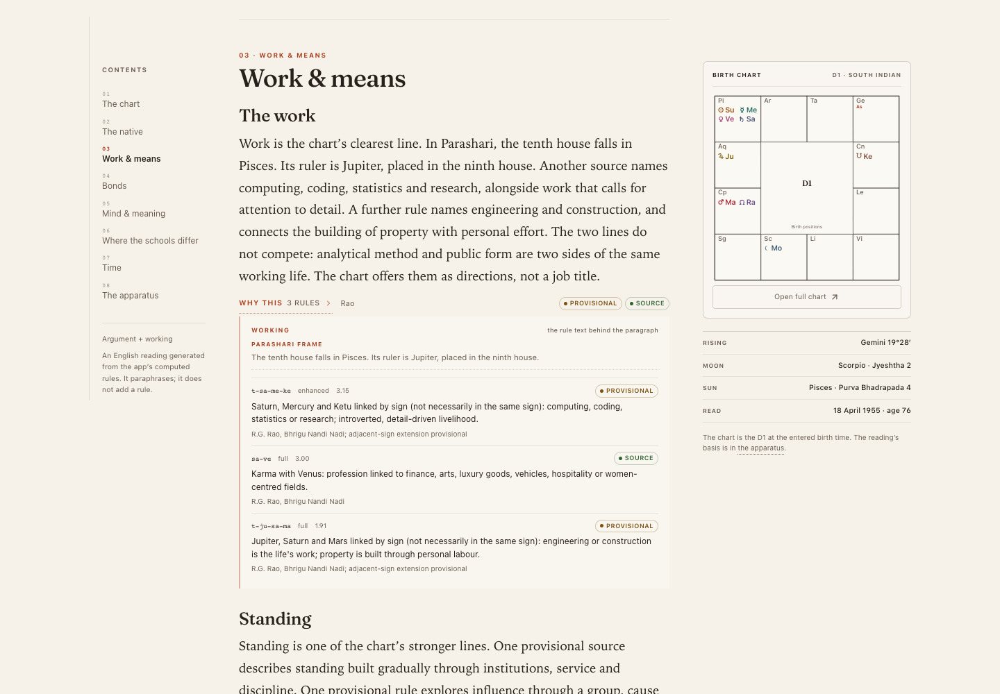
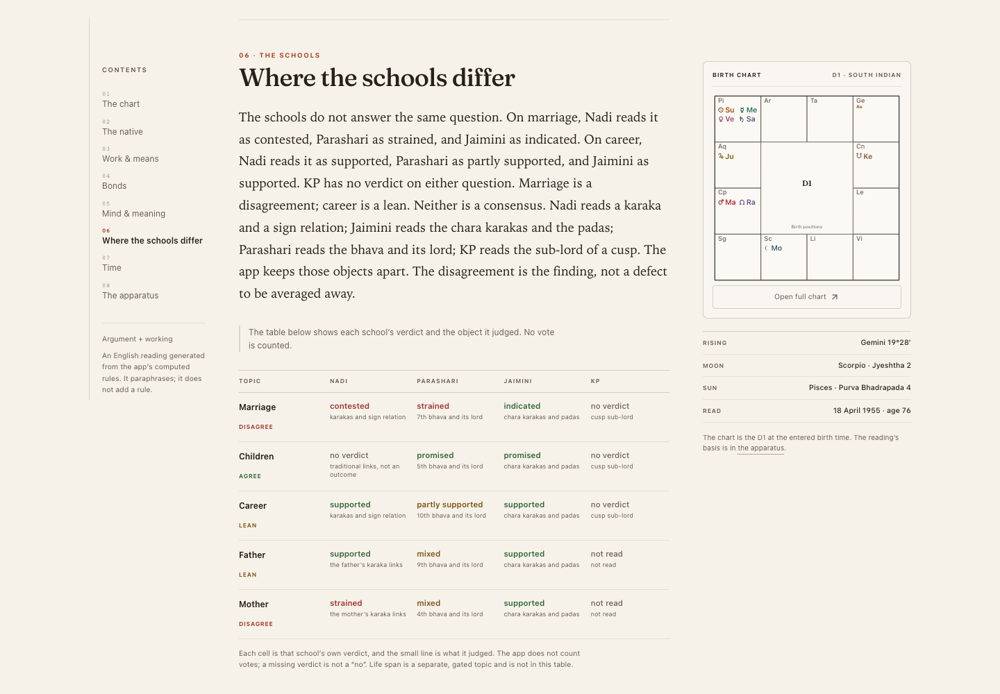
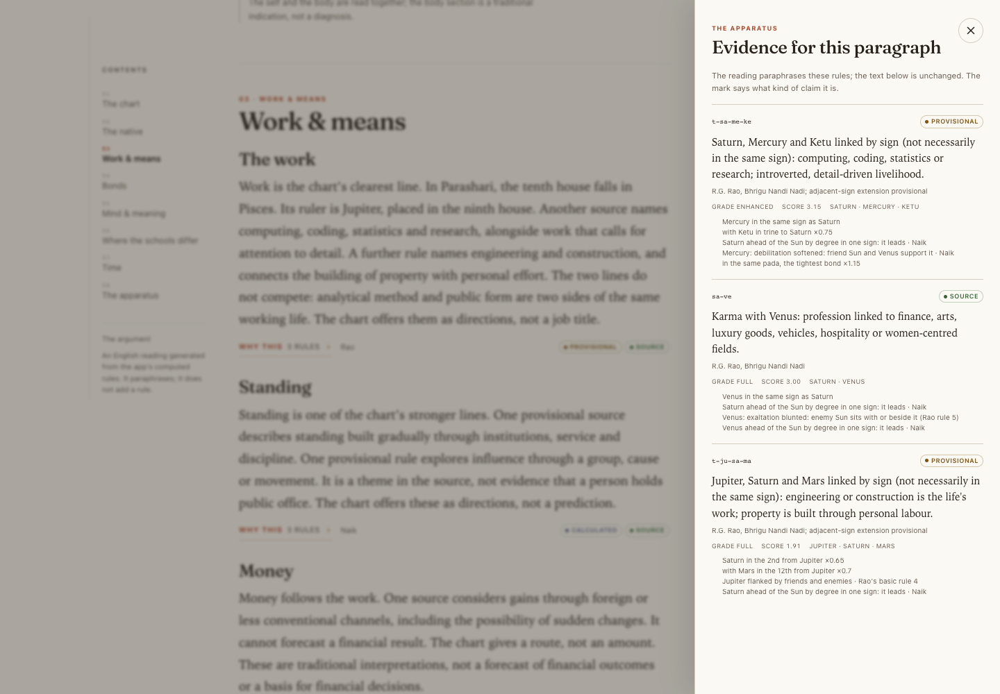
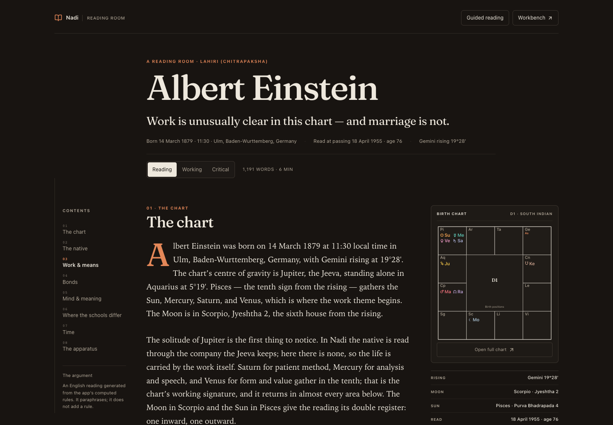
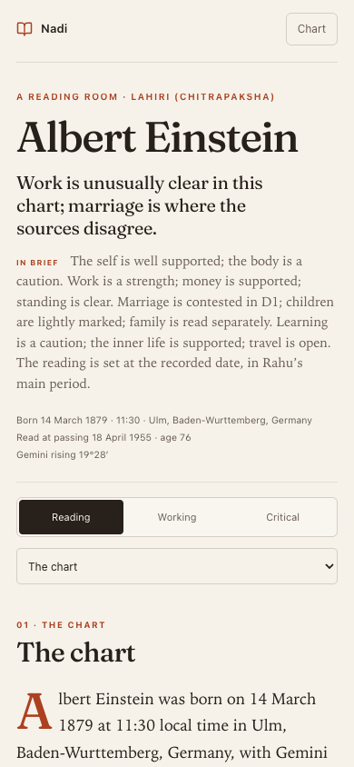
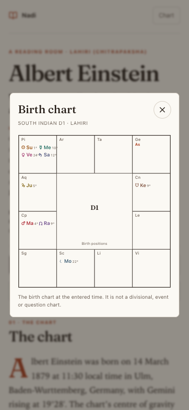

# The Reading Room

A design fork of Nadi: a new editorial surface over the same computed chart, and a deterministic prose layer that turns the rule engine's fragments into a reading a person can follow.

The workbench stays where it was. A **Reading room** link sits in the chart header; the room lives at:

```
/#/chart/:id/room
/#/chart/:id/room/working
/#/chart/:id/room/critical
```



## Why a separate room

The existing chart page is a workbench: ten tabs, each faithful to one school, each with its own working. That is the right shape for checking a rule. It is not the shape of a reading.

The review's finding was that Nadi already computes the apparatus — the rule, the source, the grade, the provisional marks — and keeps it one toggle away in Practitioner. The room keeps that finding but changes the hierarchy: **the prose first, the evidence at the claim, the working one layer down, and the apparatus at the end.**

The three layers are explicit:

- **Reading** — the argument, with source marks and a "Why this" link at the edge.
- **Working** — the same argument, plus the rule text, score, grade and source that carry each paragraph.
- **Critical** — the working, plus the grade reasons, birth-time band notes, the school methods and the provenance.

The layer lives in the URL, so a reader can link to a working paragraph or a critical view.

## V2: four chapters, eleven areas

The first release read five areas. V2 reads the whole life without becoming eleven equal sections.

| Chapter | Life areas | What it does |
|---|---|---|
| **The native** | self, health | The person first; the body as a traditional indication, not a diagnosis. |
| **Work & means** | career, authority, wealth | The working life, public standing and money as separate questions. |
| **Bonds** | marriage, children, family | The chapter where disagreement is the finding; family is read member by member. |
| **Mind & meaning** | education, spirituality, travel | The descriptive areas: learning, inner life and distance. |
| **Time** | — | The Vimshottari period, the sub-period and the slow sky, as clocks rather than events. |
| **The schools** | — | The comparison of bases: five general topics × four schools, no vote. |
| **The apparatus** | — | Sources, caveats, provenance, school cards, marks and citation. |

Every one of the eleven areas is in the **life-area index**, with its tone and its chapter. The index jumps to the area's paragraph. The chapter is the argument; the index is the completeness.

The **two-minute summary** is five lines — one per chapter — generated from the same tones and period as the full reading. It sits under the lead and opens on demand.

The **Parashari spine** comes from the upstream reader's own chart contexts: each area carries its whole-sign house frame, e.g. “the tenth house falls in Pisces; its ruler is Jupiter, placed in the ninth house.” The frame appears once in the reading and again, with the other schools, in Working. **Jaimini** contributes the chara-karaka line; **KP** contributes the cusp sub-lord and its verdict — often “no general verdict fires.” ALP is still not mapped, and Prasna Marga is not a natal voice; both stay out of the prose rather than being forced in.

## The prose layer

`shared/reading-prose.ts` is the enrichment module. It is pure and deterministic: the same chart always produces the same prose, and the prose never adds a rule that the engine did not compute.

```ts
const input = buildReadingInput(result); // synthesise + agreementFor + briefingFor + readerExperience
const doc = composeReading(input);       // chapters, summary, index, comparison, timing, provenance
```

Each area paragraph follows the same underlying movement:

1. **Claim** — what the chart says about the area: "Work is the chart's clearest line", "Marriage is where the chart becomes an argument", "The body asks for care rather than confidence."
2. **Reviewed Nadi line** — the upstream reader's selected paraphrase, not a rule dump: "Another source names computing, coding, statistics and research…"
3. **The frame** — on the first area of a chapter, the Parashari house-lord fact: "In Parashari, the tenth house falls in Pisces. Its ruler is Jupiter, placed in the ninth house."
4. **Bridge** — the writer's sentence that says what the lines mean together, where the sources support one: "The two lines do not compete: analytical method and public form are two sides of the same working life."
5. **Limit** — what the reading will not claim: "The app does not average the two", "This is a traditional indication, not a diagnosis", "The chart offers them as directions, not a job title."

The details that make it read like English rather than a table:

- **Role-aware naming.** Jupiter is "the Jeeva", Saturn "the Karma", Venus "the Kalatra" in a male chart and the spouse karaka in the app's frame. The writer expands the rule's shorthand without overloading the sentence.
- **Stable variation.** Frames for the first and second evidence rotate deterministically, so adjacent paragraphs do not open the same way. The content stays fixed.
- **Given/new.** The lead starts with the birth, the rising sign and the chart's centre of gravity; later sections refer back to "the tenth" and "the same working signature" instead of re-listing positions.
- **Source fidelity.** The rule text is never rewritten into a stronger claim. The prose paraphrases the gist and leaves the exact sentence in the evidence drawer.
- **Uncertainty in the grammar.** A contested area is allowed to be an argument; a provisional rule keeps its mark; a calculation's grade is in the working, not hidden in a footnote.
- **No forecast.** The timing section names the period and the sky and says, in the same breath, that the app does not turn them into an event.

For the Einstein chart the reading is about 1,200 words and six minutes, with eleven area paragraphs. The lead is:

> Albert Einstein was born on 14 March 1879 at 11:30 local time in Ulm, Baden-Wurttemberg, Germany, with Gemini rising at 19°28′. The chart's centre of gravity is Jupiter, the Jeeva, standing alone in Aquarius at 5°19′. Pisces — the tenth sign from the rising — gathers the Sun, Mercury, Saturn, and Venus, which is where the work theme begins. The Moon is in Scorpio, Jyeshtha 2, the sixth house from the rising.

## The display modules

- **The chart card.** The South Indian D1 stays beside the prose at wide widths; below 900px it becomes a Chart button and a focused modal. It is the same chart as the workbench, not a decorative ring.
- **Chapters with a spine.** The chart, the native, work & means, bonds, mind & meaning, the schools, time, the apparatus. Each chapter has a number and a rule above it; each area has a subheading.
- **The two-minute summary and the life-area index.** The summary is five lines; the index holds all eleven areas and jumps to the paragraph.
- **The frames.** Every area carries its Parashari house frame in Working; each chapter carries the Jaimini karaka and KP cusp lines.
- **Why this.** Every paragraph with evidence carries the mark types and a button that opens the exact rule text, source and grade.
- **The comparison.** Five general topics × four schools. Each cell is the school's own verdict and the object it judged; the row carries the combined reading. No vote is counted. Life span is a separate, gated topic and is not folded in.
- **Time.** The Vimshottari period, the sub-period, the third-level period, and the slow sky, as a structured timeline, not forty pages of paryanthar prose.
- **The apparatus.** The sources with citation counts, the caveats, the provenance, the school cards, the evidence legend, and a copyable citation.
- **The fingerprint.** A local checksum of the birth data and ayanamsa, so the same reading can be recognised. It is explicitly not a cryptographic manifest.











## Evidence marks

The marks are the review's five kinds, plus the silent case:

| Mark | Meaning |
|---|---|
| **Source** | A rule with a named source. |
| **Provisional** | The rule, or the app's extension of it, is provisional. |
| **Calculated** | The app's grading changed the weight; the reasons are in the working. |
| **Statistical** | A statistical comparison; sampling and protocol matter. |
| **App convention** | A convention, not a rule from the tradition. |
| **Silent** | No rule fires, or the school does not read the topic. |

## Run and verify

```bash
cd nadi-reading-room
npm install
npm run dev
```

Open a saved chart, then choose **Reading room** beside Report. If you want the Einstein fixture, the test composes it from `scripts/fixtures/einstein.json`; the browser needs the chart in its own Cache Storage, as the app's privacy model requires.

```bash
npm run check
npx tsx --test scripts/reading-prose.test.ts
npm run build
```

The three prose tests check the chapter shape, all eleven area paragraphs and their frames, the five-line summary and eleven-area index, determinism across two compositions, and the presence of source, provisional and calculation marks.

A teardown of a mainstream 108-page Parashari report, and what to borrow or avoid, is in [mainstream-reference.md](mainstream-reference.md).

## What this is not

- It is not an LLM. The prose is deterministic and source-bound; there is no free-form generation.
- It is not a new astrology engine. Every claim comes from the existing `synthesize`, `agreementFor`, `briefingFor` and `readerExperience` outputs; the upstream guided reader supplies the reviewed Nadi prose and the school chart contexts.
- It is not the final critical edition. Edition, page, Sanskrit variant and the app's decision are still not attached to each sentence in a formal apparatus; the drawer is the first layer of that.
- It is English-only. The upstream guided reader is bilingual; the full room does not yet carry Malayalam through its prose.
- It is not tested with readers. The prose is a design hypothesis about how this data can be made human; the next test is a reading group, not another screen.
- It does not include remedies, Prasna, or an ALP life reading. Those are separate tools, not natal voices, and forcing them into the prose would repeat the mainstream report's mistake.

## Light and dark

The room uses the app's theme tokens; there is no separate palette. The drop cap, the rules and the chart colours all come from the same set.






